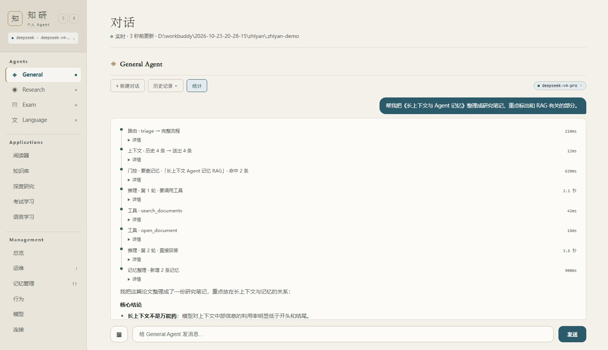
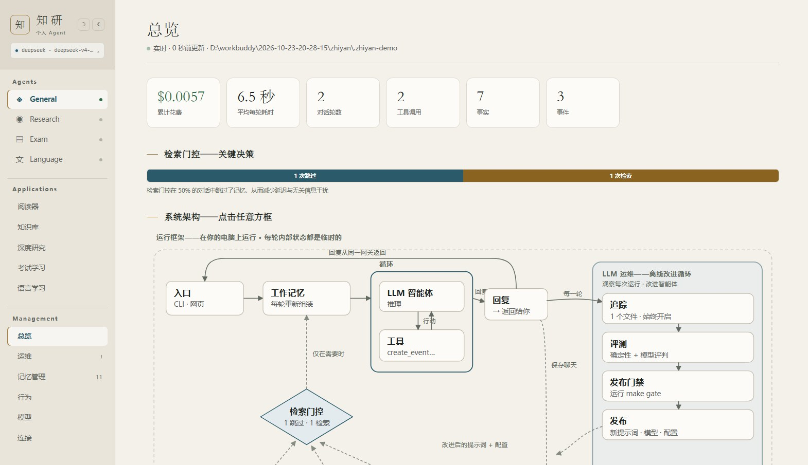
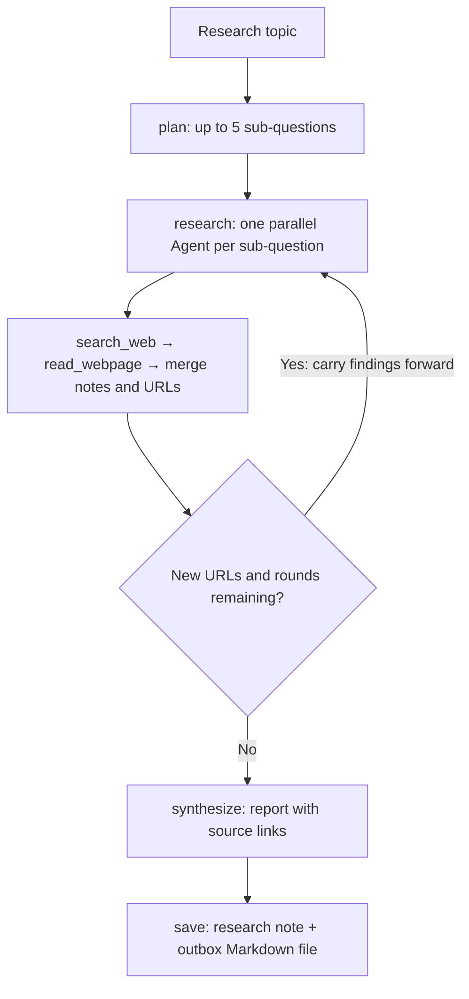
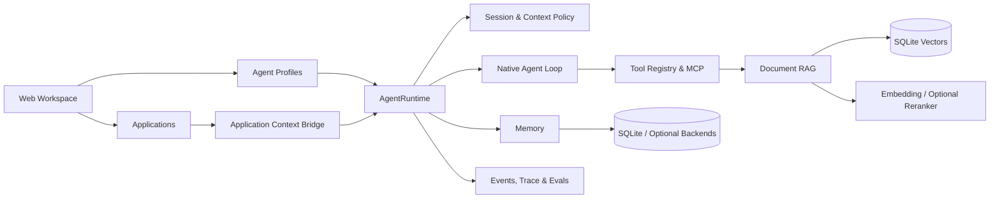

# Zhiyan

**A framework-free, extensible personal agent platform.**

Zhiyan implements the agent loop, sessions, context management, memory, tool execution, and run tracing directly in Python, then composes them into different Agents and Applications. It centers on local data, with workspaces for document reading, agent-directed RAG, and research notes.

[](pyproject.toml)
[](https://docs.astral.sh/uv/)
[](LICENSE)

[简体中文](README.md)



## Why it is a platform

The core of Zhiyan is not one fixed assistant. It is a reusable personal-agent runtime:

- **An Agent is configuration, not another runtime.** Each Agent declares its prompt, tool scope, model, context policy, and run budget, then executes on the shared `AgentRuntime`.
- **An Application is more than a chat page.** Applications keep domain state such as a document, selection, or project file, then pass that working context to an Agent through the Context Bridge.
- **Execution is observable by default.** Memory gating, context compaction, model iterations, tool calls, workflow nodes, latency, and token usage appear in the Web timeline.
- **The orchestration core does not depend on an agent framework.** Loop, Session, Context Policy, Tool Registry, and Graph Engine are implemented in this repository; provider SDKs handle model transport.

“Framework-free” refers to the orchestration layer: the core does not depend on LangChain, LangGraph, CrewAI, or a similar agent framework. It does not mean zero third-party dependencies. The Web server uses the Python standard library, SQLite is the default store, and the frontend is plain HTML, CSS, and JavaScript with no build step.

## Web workspace

Zhiyan organizes the same runtime into three product layers:

| Layer | Built-in today | Purpose |
| --- | --- | --- |
| **Agents** | General, Research, Exam, Language | Different prompts and tool scopes for everyday, research, and study work |
| **Applications** | Reader and document library, Knowledge Base, Deep Research, Exam Prep, Language Learning | Stateful work surfaces that give an Agent a concrete task environment |
| **Management** | Overview, Ops, Memory, Behaviour, Models, Connections | Inspect runtime state and manage models, memory, and integrations |

The Reader also has a dedicated embedded Agent. It receives the open document and current selection instead of answering independently from the material.



### Platform capabilities

- Multi-Agent conversations with separate threads, history restoration, and idle-session rotation.
- A native Agent Loop with model calls, tool execution, result feedback, and an iteration guardrail.
- Context management with tool-result budgets, long-result pointers, conversation trimming, and state summaries.
- Semantic, episodic, and procedural memory, with `SKILL.md` loaded on demand.
- A retrieval gate that decides whether memory is needed, generates the query, and reports its hits.
- A unified tool system with schemas, per-Agent allowlists, safe execution, and MCP support.
- An Application Context Bridge for injecting the current resource, content, selection, and UI state into a turn.
- Live and historical observability through step timelines, JSONL traces, token usage, latency, and cost.
- Document operations: upload, URL import, persistent storage, rename, delete, text search, and a separate Reader conversation for each document.
- Document RAG with automatic chunking and vector indexing, semantic retrieval, optional reranking, and source passages with page references.
- Study: exam preparation and language learning on one scheduling/review core, with source-grounded card generation, SM-2 reviews, and daily plans.
- Language practice: vocabulary scheduling, word-list import, browser TTS, dictation scoring, writing feedback, and speaking prompts — without pretending to do speech recognition or pronunciation scoring.
- A Web model workbench for providers, API keys, main/gate/summary models, and custom OpenAI- or Anthropic-compatible endpoints; embeddings and reranking have separate provider/model settings.

## Document reading and operations

The Reader keeps the library, document content, and embedded conversation in one workspace:

- **Import and manage**: upload PDF, Markdown, plain text, code, JSON, CSV, HTML, or XML, or import a public HTTP(S) URL. The per-file limit is **32 MB**; documents can be searched, renamed, and deleted.
- **Keep documents locally**: original files live in `.zhiyan/documents/`; extracted text and metadata live in SQLite. The library is shared across the workspace and survives refreshes and restarts.
- **Read long PDFs**: HTTP Range serves file segments; pdf.js renders pages and selectable text. Only pages near the viewport are rendered, with page navigation, document-wide text search, and Ctrl + wheel zoom.
- **Ask about the material**: select text and ask in the right-hand pane. The Context Bridge supplies the open document, its ID, and the selection; each document has its own conversation thread.
- **Continue reading on demand**: the context snapshot carries at most 24,000 characters of document text and states when it is truncated. The Agent can continue with character offsets through `open_document`, or retrieve a passage before checking the original.
- **Check citations**: PDF page references in the reading pane are clickable. Scanned PDFs can be viewed, but without a text layer their content cannot be extracted for search or RAG; OCR is not included.

## Document RAG: the Agent chooses how to retrieve

Both Reader and Research Agents can use document retrieval tools. The Agent chooses literal search, semantic retrieval, or further reading, then the same conversation model writes the answer.

| Tool | Purpose |
| --- | --- |
| `list_documents` | Inspect available documents and their IDs |
| `search_documents` | Search titles and text literally, returning matching excerpts |
| `semantic_search` | Retrieve passages by meaning, within one document or the whole library |
| `open_document` | Read a bounded text window and get the next character offset |
| `fetch_document` | Import a public URL into the library and read its beginning |

Indexing and retrieval follow two paths:

```text
Index: import → extract text → structural / recursive chunks → batch embeddings → SQLite vectors
Query: Agent calls semantic_search → query embedding → cosine similarity recall
       → optional reranker → passages and pages → Agent answer → Reader citation jump
```

- **Chunking**: Markdown heading hierarchies define sections; long passages split recursively by paragraphs, lines, sentences, and weaker boundaries, with overlap between neighboring chunks. PDF text is split continuously and character offsets map each chunk back to its page range.
- **Automatic indexing**: a background thread handles new documents, existing documents when embeddings are enabled, and interrupted jobs. Changing the embedding model schedules rebuilding. The library shows progress and errors, with a retry action for failed indexes.
- **Vector retrieval**: float32 vectors are stored in SQLite, normalized, and compared by cosine similarity in plain Python; the default result count is 6 passages.
- **Optional reranking**: recall 30 candidates, rerank by relevance, and return 6. If the reranker fails, the reason is logged and retrieval falls back to vector order.
- **Two retrieval choices**: literal search uses SQLite `LIKE`; semantic retrieval uses embeddings. The Agent chooses which to call; keyword and vector scores are not automatically fused.

Document RAG retrieves source passages, while personal memory retrieves facts and experiences. Personal memory defaults to SQLite FTS5/BM25 with substring matching for Chinese and Japanese text.

## How Deep Research works

Deep Research uses the custom Graph Engine for a `plan → research → synthesize → save` workflow. Within each research round, a thread pool runs sub-agents in parallel, reusing the native Agent Loop.



- **Scope and budgets**: each sub-agent has its own context and only `search_web` and `read_webpage`. Defaults are 3 rounds and 8 model iterations per sub-question per round; the page lets you adjust both budgets.
- **Continue or stop**: code extracts and deduplicates URLs from actual tool records. No new sources, or reaching the round limit, routes to synthesis. Later rounds receive earlier findings with instructions to avoid repeated research.
- **Report and persistence**: synthesis is instructed to include source links, disagreements, and unfinished sub-questions. The report is saved as a Knowledge Base note under `research` and a Markdown file in `.zhiyan/outbox/`. A failed sub-agent records its error while the other sub-questions continue.
- **Visible execution**: SSE shows the plan, rounds, search/read counts, budget usage, and latency. Run events are also stored so historical reports can replay their research process.

Start from the **Deep Research** page, `/deep_research <topic>` in chat, or `uv run zhiyan deep_research "<topic>"`; all three share the same implementation. See the [workflow definition](zhiyan/graph/workflows/deep_research.py) and [runtime binding](zhiyan/ops/deep_research.py).

## Study: exam preparation and language learning

Study has two tracks that share one `unit → plan → card → review` core, but schedule and measure differently:

| | Exam preparation | Language learning |
| --- | --- | --- |
| Core question | Syllabus coverage and retention | Vocabulary and listening/speaking/reading/writing practice |
| Unit of work | Textbook chapter / syllabus item | Word, dictation, article |
| Plan | Unit coverage to the exam date, with an honest capacity/coverage number | Daily mix: new words, review, listening, speaking, reading, writing |
| Progress | Unit completion and card accuracy | Active/mature words, target coverage, practice minutes |

```text
upload syllabus/textbook/lesson → extract units → schedule to the exam date or daily mix
→ generate candidate cards from a unit (quote must exist in the source) → user confirms
→ learn today + review what is due → SM-2 updates the next due date
```

- **Materials stay in the document library**: a study project links `documents.id`; it does not copy files. Markdown splits by headings, PDFs map page ranges back to character offsets, and short-line outlines become one unit per line.
- **The scheduler does the arithmetic**: a day never exceeds the available minutes; if the material cannot be covered before the exam, the page says so with a percentage. Replanning starts tomorrow and keeps the previous version.
- **Cards are checkable**: AI cards enter a candidate inbox, and a card whose `source_quote` is not an exact (or whitespace-folded) substring of the unit is rejected. Only confirmed cards enter review.
- **Review history is append-only**: `ease/interval/due` on the card are materialized state; `study_reviews` is the record that can recompute the schedule later.
- **Language boundaries**: TTS only reads text; dictation compares a normalized transcript; writing returns a corrected version and notes; speaking is conversation and feedback, not speech recognition or a pronunciation score.
- **Two Agents**: Exam Coach handles coverage, planning, and source-grounded questions; Language Tutor handles vocabulary, conversation corrections, and practice. Tools also check the project `kind`, so cross-track operations are rejected.

Pages are **Exam Prep** (`#exam`) and **Language Learning** (`#language`). Data lives in the lazily-created `study_*` SQLite tables; audio lives under `.zhiyan/study/audio/`. The API is `POST /api/study`; audio uses `POST /api/study/audio/upload` and `GET /api/study/audio?id=`.

The first version does not include a mistake notebook, mock exams, speech recognition, Anki import/export, or OCR.

## Technology stack

### Default implementation

| Layer | Technology | Role in Zhiyan |
| --- | --- | --- |
| Language and packaging | Python 3.11+, uv, Hatchling | Development, dependency management, and Python package builds |
| Agent orchestration | Plain Python, dataclasses, Tool Registry | AgentSpec, model/tool loop, tool allowlists, and execution budgets |
| Workflows | Custom Graph Engine, ThreadPoolExecutor | Nodes, conditional routing, parallel branches, and step limits |
| Model transport | Anthropic SDK, OpenAI SDK | Compatible protocols, tool calls, and streaming responses |
| Web backend | `http.server.ThreadingHTTPServer`, SSE | Local APIs, static files, and live runtime events |
| Web frontend | HTML/CSS/JavaScript, Fetch, browser ES module entrypoint | Workspace, documents, conversations, and timelines without a build step |
| Document parsing and display | pypdf, HTMLParser, pdf.js, IntersectionObserver | PDF extraction, HTML text extraction, selectable PDF text, and page virtualization |
| Local data | SQLite, filesystem, JSON/JSONL | Sessions, memory, notes, documents, configuration, and traces |
| Personal memory retrieval | SQLite FTS5/BM25, `LIKE` | Facts and episodes, with substring fallback for unsegmented scripts |
| Document RAG | Custom chunker, `urllib`, SQLite vector BLOBs, Python cosine scoring | Embedding/rerank requests, vector storage, and passage retrieval |
| Configuration and terminal | python-dotenv, Rich | Local environment configuration and terminal output |
| Verification | pytest, Ruff | Deterministic regression tests and lint |

Built-in provider configurations cover Anthropic, OpenAI, OpenRouter, Gemini, DeepSeek, MiniMax, Kimi, GLM, xAI, and OpenCode (Zen / Go). Custom compatible endpoints can be registered in Models; model availability depends on the endpoint and its tool-calling support.

### Optional integrations and external services

These capabilities are configured as needed and are not prerequisites for the basic workspace:

| Capability | Technology or service | Dependency extra / configuration |
| --- | --- | --- |
| Local embeddings / reranker | For example, Ollama + bge-m3, llama.cpp + bge-reranker-v2-m3 | Run compatible endpoints separately and configure their roles |
| External tools | MCP Python SDK, stdio MCP servers | `mcp`; `.zhiyan/mcp.json` |
| Semantic memory backends | Supabase / pgvector, Mem0, Zep, LangMem | `supabase` or `memory-backends` |
| Episodic memory backend | Notion | `notion` |
| Calendar | Google Calendar API / OAuth, native macOS calendar tools | `gcal`; Connections configuration |
| Web search | DuckDuckGo HTML, Tavily | Default search needs no key; Tavily uses an optional key |
| Tracing and evaluation | OpenTelemetry / OTLP, Arize Phoenix, DeepEval | `tracing` / `eval` |

Optional Python dependency groups are defined in [`pyproject.toml`](pyproject.toml). The LangMem adapter includes LangGraph as an optional dependency; the platform Agent Loop and Graph Engine remain implemented in this repository.

## Architecture



A normal turn follows this path:

```text
Web message
  → resolve AgentSpec
  → restore Session and Application Context
  → memory gate
  → fit the request through Context Policy
  → Agent Loop: model ↔ tools until a reply is ready
  → persist the conversation, memory, and trace
```

The core is intentionally explicit:

| Module | Responsibility |
| --- | --- |
| `zhiyan/core/loop.py` | Native observe → reason → act loop |
| `zhiyan/core/runtime.py` | Assembly of one complete Agent turn |
| `zhiyan/core/session.py` | Conversation history, restoration, and persistence |
| `zhiyan/core/context/` | Context budgets, compaction, and summary policies |
| `zhiyan/core/spec.py` | Reusable `AgentSpec` declarations |
| `zhiyan/core/tools.py` | Tool schemas, allowlists, and execution boundary |
| `zhiyan/memory/` | Retrieval gating, stores, consolidation, and skills |
| `zhiyan/applications/` | Application backends and the Context Bridge |
| `zhiyan/tools/documents.py` | Document listing, literal search, semantic retrieval, and windowed reading |
| `zhiyan/applications/study.py` | Study projects, units, both schedulers, SM-2, review log, and audio storage |
| `zhiyan/ops/study_cards.py` | Candidate-card generation with source-quote validation |
| `zhiyan/ops/study_language.py` | Word-list import, writing correction, and dictation feedback |
| `zhiyan/tools/study.py` | Study Agent tools, isolated by project kind |
| `zhiyan/rag/` | Chunking, embeddings, vector storage, background indexing, and reranking |
| `zhiyan/graph/` | The project's own graph runner and workflows |
| `zhiyan/ops/web/` | Local Web API and SSE event streaming |

## Quickstart

Requirements:

- Python 3.11+
- [uv](https://docs.astral.sh/uv/getting-started/installation/)
- An API key for a model provider that supports tool calling

```bash
git clone git@github.com:jingmeiWang1/zhiyan.git
cd zhiyan
uv sync
uv run zhiyan
```

The terminal prints the actual URL. Defaults are:

- Windows: `http://localhost:8888`
- macOS / Linux: `http://localhost:7777`

If the port is unavailable, Zhiyan automatically tries the following ports.

On the first launch:

1. Open **Models** in the sidebar.
2. Select a provider and enter its API key.
3. Fetch or enter a model ID, save it, and make the provider current.
4. Return to **General** and start the first conversation.

Provider settings are written to the local `.env`; custom provider definitions live in `.zhiyan/providers.json`. Both locations are ignored by Git.

### Enable document semantic retrieval (optional)

First register a custom embedding provider in **Models**. For example, register `local_ollama` with protocol `openai` and Base URL `http://127.0.0.1:11434/v1`, and prepare the `bge-m3` model in your local Ollama service. Then set the following in the project `.env`:

```dotenv
ZHIYAN_EMBED_PROVIDER=local_ollama
ZHIYAN_EMBED_MODEL=bge-m3
```

Restart Zhiyan to begin background indexing. **Both provider and model must be set to enable it.** Document reading and literal search remain available without this configuration.

For reranking, register a compatible provider exposing `/rerank`, such as `local_rerank`, and set:

```dotenv
ZHIYAN_RERANK_PROVIDER=local_rerank
ZHIYAN_RERANK_MODEL=bge-reranker-v2-m3
```

These provider IDs are examples and must match the IDs registered in Models. Embeddings, reranking, and conversation models can use different services; local services are started separately by the user. See the [development guide](docs/DEVELOPMENT_GUIDE.md#文档库的语义检索rag) and [`.env.example`](.env.example) for configuration and implementation details.

## Extend with your own Agent

Every Agent runs on the same `AgentRuntime`. Adding one mainly means declaring an `AgentProfile`:

```python
AgentProfile(
    id="planner",
    name="Planner",
    icon="◇",
    description="Turn complex goals into executable plans.",
    spec=AgentSpec(
        name="planner",
        system_prompt="You are a planning agent...",
        tools=frozenset({"search_web", "save_note"}),
    ),
)
```

The runtime continues to own sessions, context, memory, tool execution, and tracing. An Agent only declares what makes it different.

## Extend with your own Application

An Application is a stateful work surface, not a second Agent Core. A new Application normally needs to:

1. Implement domain data and actions under `zhiyan/applications/`.
2. Add its Web API and frontend view.
3. Publish the current resource, content, selection, or UI state through `ApplicationContextBridge`.
4. Pass the rendered Application Context into the target Agent's next turn.

This makes it possible to add mail, project management, data analysis, or other workspaces without copying the Agent Loop. See [`docs/DEVELOPMENT_GUIDE.md`](docs/DEVELOPMENT_GUIDE.md) for the relevant code paths.

## Data and security boundaries

- The Web server only binds to `127.0.0.1`.
- Local data lives under `.zhiyan/`; the primary store is SQLite `state.db`.
- API keys live in the local `.env`. The Web UI reports whether a key is configured but does not return the full value.
- Conversations and tool context are sent to the selected model provider. Document chunks and retrieval queries are sent to the configured embedding / reranker endpoints; local endpoints can process this part on your machine.
- Study projects, units, cards, and review logs live in the `study_*` SQLite tables; listening audio lives under `.zhiyan/study/audio/`. Card generation and writing correction send the relevant unit/writing text to the model provider; TTS uses the browser's own speech synthesis and does not go through the provider.
- Calendar, Notion, search, or MCP integrations make their corresponding external requests.

See [`SECURITY.md`](SECURITY.md) for the full security model.

## Development and verification

Install development dependencies:

```bash
uv sync --extra dev
```

Run lint and the offline deterministic suite:

```bash
uv run ruff check zhiyan evals
uv run python -m pytest -q evals/deterministic
```

The deterministic suite uses a scripted client instead of a real model, so it requires no API key or network access.

A separate [90-task Agent evaluation dataset](evals/agent_benchmark/README.md) covers tool use, context compression, and Agentic RAG with fixed fixtures, gold labels, and offline validation. A real-model runner and performance results are not included yet.

## Documentation

- [`docs/DEVELOPMENT_GUIDE.md`](docs/DEVELOPMENT_GUIDE.md): code map and how to extend Agents, Applications, and Tools
- [`SECURITY.md`](SECURITY.md): local data, model requests, and tool permission boundaries


## License

[MIT](LICENSE)
