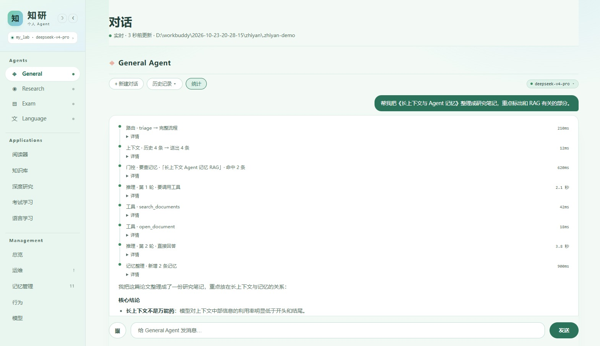
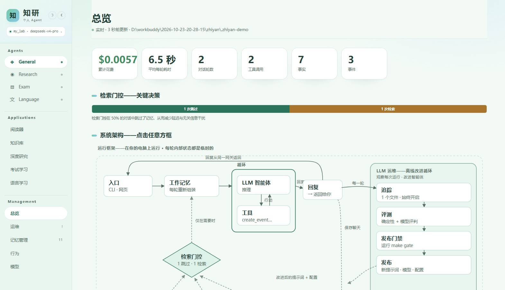
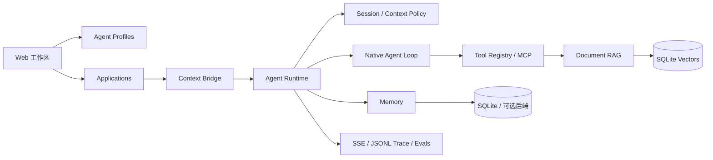
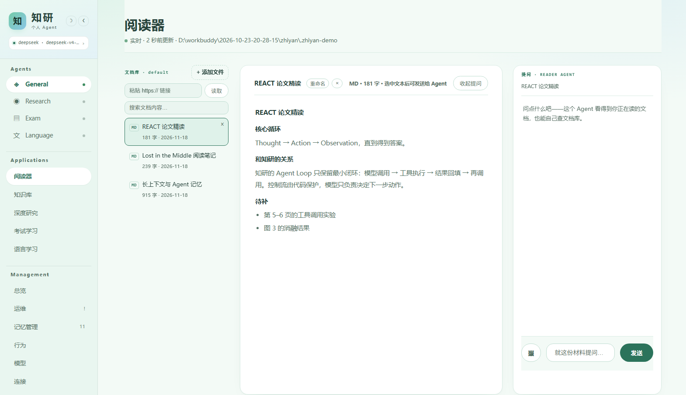
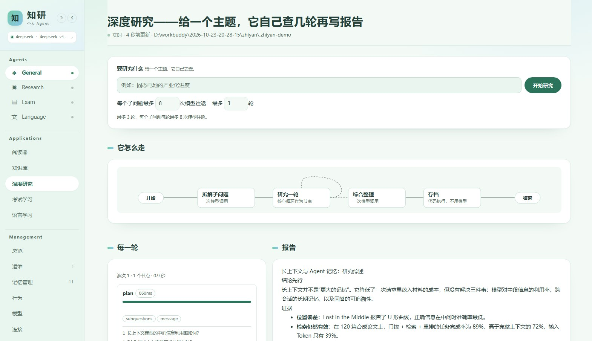
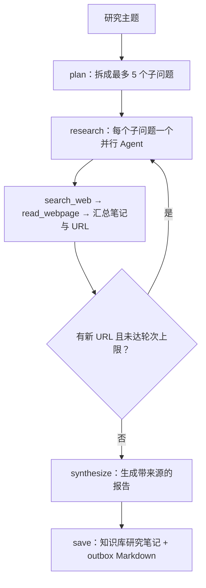
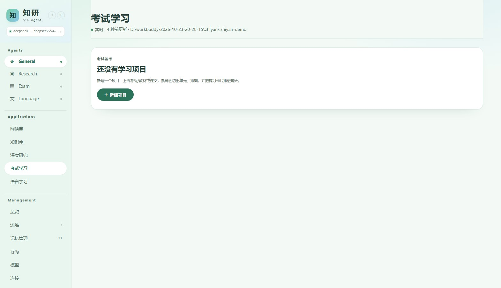
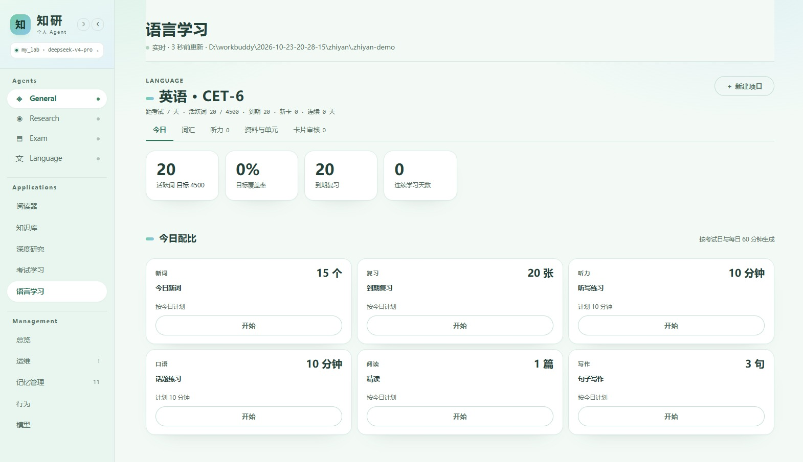
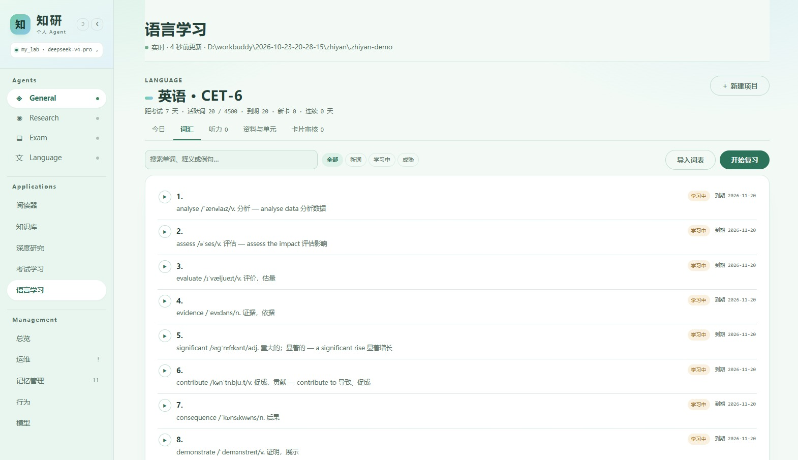
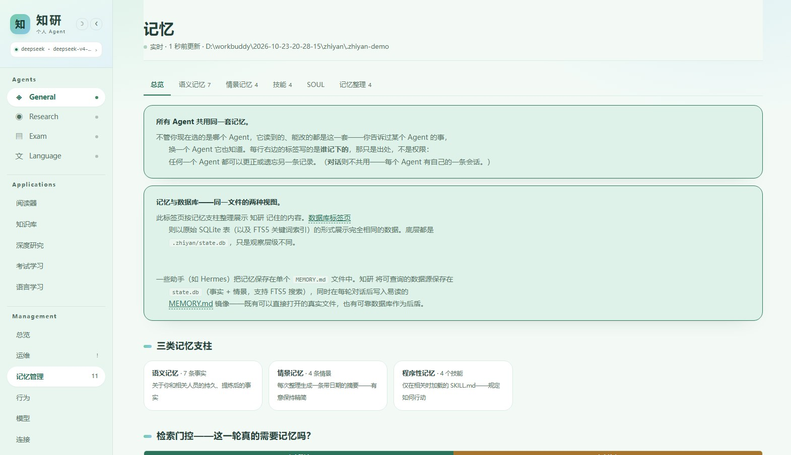

# 知研

**一个无框架、可扩展、本地优先的个人 Agent 平台。**

知研（Zhiyan）用原生 Python 实现 Agent Loop、会话、上下文策略、记忆、工具调度、工作流和运行轨迹，再把这些能力组合成不同的 Agent 与 Application。默认存储是 SQLite，Web 前端没有构建步骤，模型通过服务商 SDK 接入。

它不依赖 LangChain、LangGraph、CrewAI 等 Agent 框架；编排层、图执行器、记忆检索和前端都在仓库里直接实现。

[](pyproject.toml)
[](https://docs.astral.sh/uv/)
[](LICENSE)
[](#配置与本地数据)

[English](README.en.md)

| 对话 | 总览 |
| --- | --- |
|  |  |

## 为什么是一个 Platform

知研不是一个固定助手，而是一套可以反复组合的个人 Agent 运行底座：

- **Agents** 由提示词、工具白名单、模型、上下文策略和运行预算组成，共用同一个 `AgentRuntime`。
- **Applications** 维护文档、选区、学习项目等工作现场，再通过 Context Bridge 把当前页面状态交给 Agent。
- **一条可见的运行链** 记忆门控、上下文压缩、模型迭代、工具调用、工作流节点、耗时和 Token 都会进入 Web 时间线。
- **本地优先** 会话、记忆、文档、笔记、学习记录和轨迹都在本机；除了你配置的模型与外部服务，没有额外的托管后端。
- **小而明确的实现** 核心编排没有框架魔法，读代码就能知道一轮对话发生了什么。

## 内置 Agents

| Agent | 职责 |
| --- | --- |
| **General** | 日常助理，可以使用当前已连接的全部工具 |
| **Research** | 检索、比较来源，读写文档库，把结论沉淀为可追溯的研究笔记 |
| **Reader** | 嵌在阅读器里的专用 Agent，收到当前文档与选区，而不是脱离材料回答 |
| **Exam Coach** | 按考纲和教材排期，陪过单元、生成候选卡、盯到期复习 |
| **Language Tutor** | 词汇、听力、写作和口语练习，按真实词量控制难度 |

## 内置 Applications

| Application | 作用 |
| --- | --- |
| **阅读器 · 文档库** | 上传或导入文档，阅读、选区提问、检索原文、管理文档 |
| **知识库** | 用文件夹和 `[[双链]]` 组织笔记，Agent 可以检索、引用和更新 |
| **深度研究** | 一个主题 → 拆子问题 → 并行检索 → 汇总成带来源的报告 |
| **考试学习** | 资料切单元、按天排期、从原文生成候选卡、SM-2 复习 |
| **语言学习** | 每日练习配比、词汇调度、听写、写作批改与口语对话 |

## 架构



一次普通对话会经过：

```text
Web 消息
  → 读取当前 AgentSpec
  → 恢复 Session 与 Application Context
  → 记忆门控
  → Context Policy 调整请求窗口
  → Agent Loop：模型 ↔ 工具，直到得到回复
  → 保存会话、记忆和运行轨迹
```

核心模块：

| 模块 | 职责 |
| --- | --- |
| `zhiyan/core/loop.py` | 原生 observe → reason → act 循环 |
| `zhiyan/core/runtime.py` | 组装一次完整的 Agent Turn |
| `zhiyan/core/session.py` | 会话历史、恢复与持久化 |
| `zhiyan/core/context/` | 上下文预算、裁剪和摘要策略 |
| `zhiyan/core/spec.py` | 可复用的 `AgentSpec` |
| `zhiyan/core/tools.py` | 工具 Schema、白名单和执行边界 |
| `zhiyan/memory/` | 记忆门控、检索、整理与技能 |
| `zhiyan/applications/` | Application 后端与 Context Bridge |
| `zhiyan/rag/` | 切块、Embedding、向量存储、后台索引与重排 |
| `zhiyan/graph/` | 自研图执行器和工作流 |
| `zhiyan/ops/web/` | 本地 Web API 与 SSE 事件流 |

## 文档阅读与 RAG

阅读器把文档库、正文和内嵌问答放在同一个工作区：



- 上传 PDF、Markdown、纯文本、代码、JSON、CSV、HTML、XML，或导入公开 HTTP(S) URL；单文件上限 32 MB。
- 原文件保存在 `.zhiyan/documents/`，正文与元数据存入 SQLite；刷新和重启后仍可打开。
- 长 PDF 支持 Range 请求、pdf.js 渲染、页码跳转、文内搜索和 Ctrl + 滚轮缩放。
- 选中文字即可在右侧提问；Context Bridge 会把当前文档、文档 ID 和选区交给 Reader Agent。
- 上下文快照中的正文最多 24,000 字，截断时会注明全文长度；Agent 可以用 `open_document` 按字符偏移继续读。

文档检索由 Agent 自己选择工具：

| 工具 | 用途 |
| --- | --- |
| `list_documents` | 查看文档库与文档 ID |
| `search_documents` | 按字面搜索标题和正文 |
| `semantic_search` | 按意思检索段落，可限定当前文档或整个文档库 |
| `open_document` | 按字符偏移读取一段正文 |
| `fetch_document` | 抓取公开 URL，保存到文档库并读取开头 |

```text
索引：文档入库 → 提取正文 → 结构与递归切块 → 批量 embedding → SQLite 向量
检索：问题 embedding → 余弦相似度召回 → 可选 reranker → 段落与页码 → Agent 回答
```

- **切块**：Markdown 按标题层级分章节，长段落递归切分并保留重叠；PDF 按连续文本切块，再映射回页码。
- **自动索引**：后台线程处理新文档和中断任务；更换 embedding 模型后自动重建。
- **向量检索**：向量以 float32 存在 SQLite，归一化后用纯 Python 计算余弦相似度。
- **可选重排**：配置 reranker 后先召回 30 条候选，再重排取 6 条；失败时记录原因并退回向量顺序。
- **两种检索各司其职**：字面搜索用 SQLite `LIKE`，语义搜索用 embedding，由 Agent 决定调用哪一个。

## 深度研究

深度研究使用自研 Graph Engine，把一个主题组织成 `plan → research → synthesize → save` 工作流；每轮研究内部用线程池并行运行子 Agent，复用原生 Agent Loop。





- 每个子 Agent 有独立上下文，只能调用 `search_web` 和 `read_webpage`。
- 代码从真实工具记录提取并去重 URL；没有新增信源或达到轮次上限就进入汇总。
- 报告要求附来源链接、说明证据冲突和未查完的子问题。
- 报告写入知识库的 `research` 文件夹，同时保存到 `.zhiyan/outbox/`。
- 单个子 Agent 失败会记录原因，其余子问题继续。

## 学习：考试备考与语言学习







两条轨道共用「单元 → 计划 → 卡片 → 复习记录」，但计划形状和交互不同：

| | 考试备考 | 语言学习 |
| --- | --- | --- |
| 核心问题 | 考纲覆盖与记忆保持 | 词汇量与听说读写练习 |
| 原子对象 | 教材章节 / 考纲条目 | 词条、听写、文章 |
| 计划 | 到考试日的单元覆盖，含容量与覆盖率提示 | 每日练习配比：新词、复习、听力、口语、阅读、写作 |
| 度量 | 单元完成度、卡片正确率 | 活跃词、成熟词、目标词量覆盖、练习分钟 |

```text
上传考纲/教材/课文 → 切出单元 → 按考试日或每日配比排期
→ 从单元生成候选卡（校验原文引文）→ 用户确认
→ 每日学习 + 到期复习 → SM-2 更新下次到期
```

- **资料复用文档库**：学习项目只关联 `documents.id`，不复制文件。
- **计划由代码算**：每天不超过可用分钟；考试前覆盖不完会明确显示百分比。
- **卡片必须可核对**：AI 生成的卡片先进入待确认区，`source_quote` 必须是单元原文的子串。
- **复习日志只追加**：卡片上的 `ease/interval/due` 是物化结果，`study_reviews` 才是事实。
- **语言练习的边界**：TTS 只朗读文本；听写用 transcript 比对；写作只给修改稿和说明；口语只做对话与反馈，不做语音识别或发音评分。

## 记忆

知研把个人记忆分成三类，默认都落在本地 SQLite：

| 类型 | 内容 | 默认检索 |
| --- | --- | --- |
| **语义事实** | 偏好、关系、长期设定 | SQLite FTS5/BM25，中文和日文补充子串匹配 |
| **情景记忆** | 某天发生了什么、做过什么 | 时间与关键词检索 |
| **程序性记忆** | `SKILL.md` 写的步骤和规则 | Agent 按需读取 |



- **记忆门控**：先判断当前问题需不需要记忆，再生成检索词，命中结果会出现在运行时间线里。
- **共享记忆池**：所有 Agent 读写同一套事实、情景和笔记；记录里的 `agent_id` 只表示“谁写下的”。
- **可整理**：支持合并、修正和遗忘；整理结果保留来源，方便回看。
- **可选后端**：Supabase/pgvector、Mem0、Zep、LangMem、Notion 都可以按需配置，SQLite 始终是默认。

## 模型与集成

内置服务商包括 Anthropic、OpenAI、OpenRouter、Gemini、DeepSeek、MiniMax、Kimi、GLM、xAI 和 OpenCode（Zen / Go）。也可以在「模型」页登记 OpenAI / Anthropic 兼容端点。

- **角色模型**：主模型、记忆门控、摘要、Embedding、Reranker 可以分别配置。
- **集成**：Google Calendar、Apple Calendar、Notion、Supabase、Tavily 等在 `.env` 中按需启用，`zhiyan connections` 查看状态。
- **MCP**：在 `.zhiyan/mcp.json` 中登记 stdio MCP Server。
- **本地模型**：Embedding 和 Reranker 可以指向 Ollama、llama.cpp 等本地兼容端点。

## 可观测性

- Web 时间线实时显示记忆门控、上下文压缩、模型迭代、工具调用、工作流节点、耗时与 Token。
- 每轮对话保存为 JSONL Trace（`.zhiyan/traces/`），历史报告可以回放研究过程。
- 「运维」页汇总调用次数、Token、费用、工具错误和平均耗时。
- 可选接入 OpenTelemetry / Arize Phoenix 查看瀑布图。

## 快速开始

需要：

- Python 3.11+
- [uv](https://docs.astral.sh/uv/getting-started/installation/)
- 任意一个支持工具调用的模型服务商 API Key

```bash
git clone git@github.com:jingmeiWang1/zhiyan.git
cd zhiyan
uv sync
uv run zhiyan
```

终端会打印实际访问地址，默认：

- Windows：`http://localhost:8888`
- macOS / Linux：`http://localhost:7777`

端口不可用时会自动尝试后续端口。

首次启动后：

1. 打开左侧「模型」页。
2. 选择服务商并填写 API Key。
3. 获取或填写模型 ID，保存并设为当前服务商。
4. 回到 General 开始第一段对话。

## 配置与本地数据

- `.env`：当前服务商、主模型、角色模型和各服务商 Key。Web 的模型页会写入这里。
- `.zhiyan/providers.json`：自定义服务商结构。
- `.zhiyan/state.db`：会话、记忆、笔记、文档元数据、学习记录等。
- `.zhiyan/documents/`：上传的原文件。
- `.zhiyan/outbox/`：研究草稿、消息草稿等输出。
- `.zhiyan/traces/`：按天保存的 JSONL 运行轨迹。

`.env` 和 `.zhiyan/` 都已被 Git 忽略。API Key 只保存在本地，并且只会随请求发送给你配置的服务商。

## 项目结构

```text
zhiyan/
  core/          Agent Loop、Session、Context Policy、Tool Registry
  agents/        内置 Agent Profile
  applications/  文档库、知识库、学习等 Application 后端
  tools/         文档、知识、日历、消息、MCP 等工具
  memory/        语义 / 情景 / 程序性记忆
  rag/           切块、Embedding、向量存储、索引与重排
  graph/         图执行器与工作流（triage / gather / deep research）
  ops/web/       本地 Web API、SSE 和静态工作区
  ops/static/    原生 HTML / CSS / JavaScript（无构建）
skills/          程序性记忆（SKILL.md）
evals/           确定性测试、LLM-as-judge、离线评测集
sql/             Supabase 初始化脚本
```

## 开发与测试

```bash
make run          # 启动 Web 工作区
make web          # 同上
make brief        # 日历 + 邮件 + 记忆的晨间简报（Loop）
make gather       # 多来源并行抓取后汇总（Graph）
make lint         # ruff
make eval         # 确定性测试，不调用模型
make eval-judge   # LLM-as-judge，需要 API Key
make gate         # 发布门禁：确定性测试 + judge 阈值
```

评测材料在 `evals/`：

- `evals/deterministic/`：不联网、不调用模型的回归测试。
- `evals/judge/`：需要模型参与的回答质量评测。
- `evals/agent_benchmark/`：83 条离线任务，覆盖工具调用、上下文工程和文档 RAG；`validate.py` 会离线校验标准调用与证据。

开发约定和模块说明见 [docs/DEVELOPMENT_GUIDE.md](docs/DEVELOPMENT_GUIDE.md)。

## 设计取舍与边界

- **单用户、本地优先**：这不是多租户 SaaS，也没有面向公网部署的权限和限流；默认只监听 `127.0.0.1`。
- **不做 OCR**：扫描版 PDF 可以浏览，但没有文字层时无法提取正文供搜索和 RAG 使用。
- **不假装能力**：语音只做 TTS 朗读，不做语音识别或发音评分；口语练习是对话与反馈，不是考试评分。
- **检索不是万能**：语义检索依赖 Embedding 质量；没有配置 reranker 时按向量顺序返回。
- **模型输出需要核对**：涉及金额、日期、医疗、法律等高风险内容时，请把 Agent 的结论当作草稿，而不是最终答案。
## License

[MIT](LICENSE)
