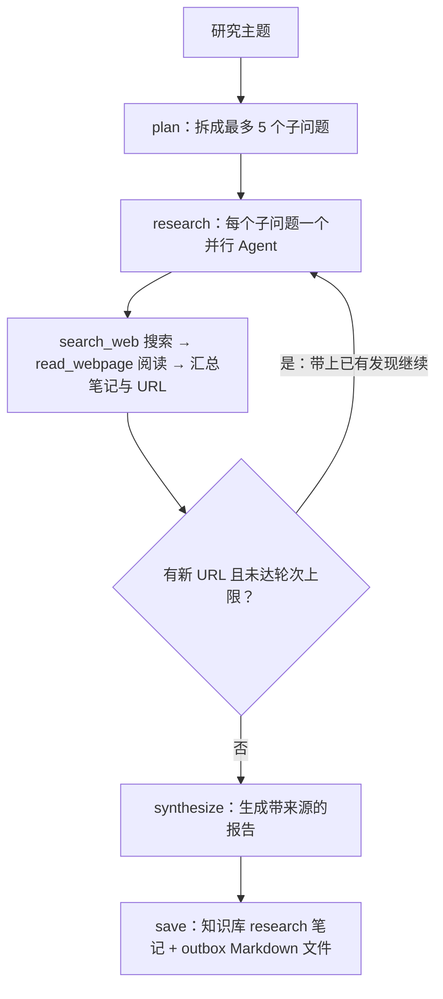
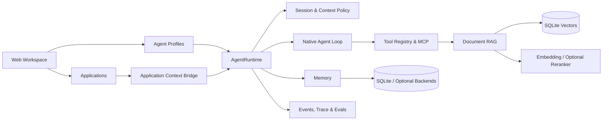

# 知研 (KnowMe)

**一个无框架、可扩展的 Personal Agent Platform。**

知研（KnowMe）用原生 Python 实现 Agent Loop、会话、上下文管理、记忆、工具调度和运行轨迹，再把这些能力组合成不同的 Agent 与 Application。它以本地数据为中心，提供文档阅读、Agent 自主检索的 RAG、研究笔记和健康管理工作区。

[](pyproject.toml)
[](https://docs.astral.sh/uv/)
[](LICENSE)

[English](README.en.md)


## 为什么是一个 Platform

KnowMe 的核心不是某一个固定助手，而是一套可以反复组合的个人 Agent 运行底座：
- **Agents** 每个 Agent 由提示词、工具范围、模型、上下文策略和运行预算组成，共用同一个 `AgentRuntime`。
- **Application** Application 可以维护文档、选区、项目文件等页面状态，再通过 Context Bridge 把当前工作现场交给 Agent。
- **运行过程可视化。** 一轮对话里的记忆门控、上下文压缩、模型迭代、工具调用、工作流节点、耗时和 Token 都会进入 Web 时间线。
- **核心编排没有依赖 Agent 框架。** Loop、Session、Context Policy、Tool Registry 和 Graph Engine 都在仓库中直接实现，模型通信使用服务商 SDK。

这里的“无框架”指 Agent 编排层不依赖 LangChain、LangGraph、CrewAI 等框架，并不表示项目没有第三方依赖。Web 服务使用 Python 标准库，默认存储使用 SQLite，前端是原生 HTML、CSS 和 JavaScript，没有构建步骤。
## Web 工作区

KnowMe 把同一套运行时组织成三个层次：

| 层次 | 当前内置内容 | 作用 |
| --- | --- | --- |
| **Agents** | General、Research、Health | 用不同提示词和工具范围处理日常、研究和健康任务 |
| **Applications** | 阅读器与文档库、知识库、深度研究、健康 · 训练 | 给 Agent 提供具体工作场景、状态和交互界面 |
| **Management** | 总览、运维、记忆管理、行为、模型、连接 | 查看运行状态并管理模型、记忆和外部集成 |

Reader 还有一个嵌在阅读器中的专用 Agent。它会收到当前文档和选区，而不是脱离材料自由回答。

Health Agent 则是有手的那种：它读写的是健康应用里那六张表（身体指标、训练、饮食、每日目标、
食物库、计划），你说一句"帮我记一下"它就真往库里写；说"150 克鸡胸肉"它会去食物库查每 100 克的
数值**自己算**，不凭印象报热量；定计划前会先查你的真实数据，需要依据的结论用搜索工具去找，
查不到就说这是常规做法而不是研究结论。它不是医生。


### 平台当前提供的能力

- 多 Agent 会话：独立对话线程、历史恢复、空闲后自动开启新会话。
- 原生 Agent Loop：模型调用、工具执行、结果回填和最大迭代保护。
- 上下文管理：工具结果预算、长结果指针化、会话裁剪和状态摘要。
- 三类记忆：语义事实、情景记录和按需读取的 `SKILL.md` 程序性记忆。
- 记忆门控：先判断当前问题是否需要记忆，再生成检索词并展示命中结果。
- 工具系统：统一 Schema、Agent 工具白名单、安全执行和 MCP 扩展。
- Application Context Bridge：把页面中的资源、正文、选区和状态注入当前会话。
- 可观测性：实时步骤、历史回放、JSONL Trace、Token、耗时和费用统计。
- 文档操作：文件上传、URL 导入、持久保存、重命名、删除、正文搜索，以及每份文档独立的 Reader 对话。
- 文档 RAG：自动切块和向量索引，按意思检索，可选重排，返回带页码的原文供 Agent 回答。
- 模型工作台：在 Web 中配置服务商、API Key、主模型、门控模型和摘要模型，也可添加 OpenAI/Anthropic 兼容端点；embedding 和 reranker 可分别配置服务商与模型。

## 文档阅读与操作

阅读器把文档库、正文和内嵌问答放在同一个工作区：

- **导入与管理**：上传 PDF、Markdown、纯文本、代码、JSON、CSV、HTML、XML，或粘贴公开 HTTP(S) URL。单份文件上限为 **32 MB**；支持列表搜索、重命名和删除。
- **本地持久化**：原文件保存在 `.knowme/documents/`，提取的正文和元数据存入 SQLite。文档库由整个工作区共享，刷新和重启后仍可打开。
- **长 PDF 阅读**：后端支持 HTTP Range，前端用 pdf.js 渲染页面与可选中的文字层；只渲染视野附近的页面，支持页码跳转、文内搜索和 Ctrl + 滚轮缩放。
- **结合原文提问**：选中文字后可在右侧提问，Context Bridge 把当前文档、文档 ID 和选区交给 Reader Agent；每份文档有自己的对话线程。
- **按需继续读**：上下文快照中的正文最多 24,000 字，截断时会注明全文长度。Agent 可用 `open_document` 的字符偏移继续读取，也可先检索再核对原文。
- **可核对的引用**：阅读器里，回答中的 PDF 页码可点击跳转。扫描版 PDF 可以浏览，但没有文字层时无法提取正文供搜索和 RAG 使用；当前不包含 OCR。

## 文档 RAG：由 Agent 决定怎么找

Reader 和 Research Agent 都能使用文档检索工具。Agent 根据问题选择字面搜索、语义检索或继续读原文，再用同一个对话模型生成回答。

| 工具 | 用途 |
| --- | --- |
| `list_documents` | 查看文档库中的材料和文档 ID |
| `search_documents` | 按字面搜索标题与正文，返回命中片段 |
| `semantic_search` | 按意思找段落，可限定当前文档或搜索整个文档库 |
| `open_document` | 按字符偏移读取一段正文，并获得继续读取的位置 |
| `fetch_document` | 抓取公开 URL，保存到文档库并读取开头 |

索引和检索走两条路径：

```text
索引：文档入库 → 提取正文 → 结构与递归切块 → 批量 embedding → SQLite 向量存储
检索：Agent 调用 semantic_search → 问题 embedding → 余弦相似度召回
      → 可选 reranker 重排 → 段落与页码 → Agent 回答 → 阅读器跳转核对
```

- **切块**：Markdown 按标题层级分章节，长段落递归按段落、行、句子等切分，相邻块保留重叠。PDF 按连续文本切块，再把字符偏移映射回页码范围。
- **自动索引**：后台线程处理新文档、启用前已入库的文档和中断的任务；更换 embedding 模型后自动重建。文档列表显示进度和错误，失败后可点击重新索引。
- **向量检索**：向量以 float32 存在 SQLite，归一化后用纯 Python 计算余弦相似度，默认返回 6 条段落。
- **可选重排**：配置 reranker 后，先召回 30 条候选，再按相关性重排取 6 条；重排服务失败时记录原因并退回向量顺序。
- **两种检索各有用途**：字面搜索用 SQLite `LIKE`，语义搜索用 embedding。两者由 Agent 选择调用，当前没有关键词与向量分数自动融合的排序器。

文档 RAG 与个人记忆是两套用途不同的检索：前者找文档段落，后者找个人事实和经历；个人记忆默认使用 SQLite FTS5/BM25，并为中文和日文补充子串匹配。

## 深度研究(Deepr esearch)

深度研究使用自研 Graph Engine，把一个主题组织成 `plan → research → synthesize → save` 工作流。每轮研究内部用线程池并行运行子 Agent，复用原生 Agent Loop。



- **分工与预算**：每个子 Agent 有独立上下文，只能调用 `search_web` 和 `read_webpage`。默认最多 3 轮、每个子问题每轮最多 8 次模型往返，页面可调整预算。
- **继续还是停止**：代码从真实工具记录提取、去重 URL；没有新增信源或达到轮次上限就进入汇总。后续轮次带上已有发现，提示 Agent 避免重复研究。
- **报告与保存**：汇总时要求附来源链接、说明证据冲突和未查完的子问题；报告写入知识库的 `research` 文件夹，并保存到 `.knowme/outbox/`。单个子 Agent 失败会记录原因，其余子问题仍继续。
- **过程可见**：SSE 实时展示规划、轮次、搜索与阅读次数、预算使用和耗时；运行事件同时保存，历史报告可回放研究过程。

可从 **深度研究** 页面、聊天命令 `/deep_research <主题>` 或 `uv run knowme deep_research "<主题>"` 启动，三种入口共用同一实现。代码见 [工作流定义](knowme/graph/workflows/deep_research.py)与 [运行绑定](knowme/ops/deep_research.py)。

## 技术栈

### 默认实现

| 层次 | 技术 | 在项目中做什么 |
| --- | --- | --- |
| 语言与包管理 | Python 3.11+、uv、Hatchling | 开发、依赖管理与 Python 包构建 |
| Agent 编排 | 原生 Python、dataclass、Tool Registry | AgentSpec、模型与工具循环、工具白名单与运行预算 |
| 工作流 | 自研 Graph Engine、ThreadPoolExecutor | 节点、条件路由、并行分支与执行步数保护 |
| 模型通信 | Anthropic SDK、OpenAI SDK | 对接两类兼容协议，并适配工具调用与流式回复 |
| Web 后端 | `http.server.ThreadingHTTPServer`、SSE | 本地 API、静态文件和实时运行事件 |
| Web 前端 | 原生 HTML/CSS/JavaScript、Fetch、浏览器 ES module 入口 | 工作区、文档操作、对话与时间线；无需前端构建 |
| 文档解析与显示 | pypdf、HTMLParser、pdf.js、IntersectionObserver | PDF 提取、HTML 正文提取、PDF 文字层与页面虚拟化 |
| 本地数据 | SQLite、文件系统、JSON/JSONL | 会话、记忆、笔记、文档、健康记录、配置和轨迹 |
| 个人记忆检索 | SQLite FTS5/BM25、`LIKE` | 事实与经历检索、中文等文本的子串补充匹配 |
| 文档 RAG | 自研切块器、`urllib`、SQLite 向量 BLOB、纯 Python 余弦计算 | 调用 embedding/rerank 端点、存储向量与召回段落 |
| 配置与终端 | python-dotenv、Rich | 本地环境配置和终端输出 |
| 验证 | pytest、Ruff | 确定性回归测试与静态检查 |

内置模型服务商配置包括 Anthropic、OpenAI、OpenRouter、Gemini、DeepSeek、MiniMax、Kimi、GLM、xAI 和 OpenCode（Zen / Go）。也可在模型页登记自己的兼容端点；具体模型是否可用取决于端点及其工具调用能力。

### 可选集成与外部服务

这些能力按需配置，不是启动基础工作区的前置条件：

| 能力 | 技术或服务 | 依赖组 / 配置入口 |
| --- | --- | --- |
| 本地 embedding / reranker | 例如 Ollama + bge-m3、llama.cpp + bge-reranker-v2-m3 | 自行运行兼容端点，配置 embedding / reranker 角色 |
| 外部工具 | MCP Python SDK、stdio MCP Server | `mcp`；`.knowme/mcp.json` |
| 语义记忆后端 | Supabase / pgvector、Mem0、Zep、LangMem | `supabase` 或 `memory-backends` |
| 情景记忆后端 | Notion | `notion` |
| 日历 | Google Calendar API / OAuth、macOS 原生日历工具 | `gcal`；连接页配置 |
| Web 搜索 | DuckDuckGo HTML、Tavily | 默认搜索无需 Key；Tavily 按需配置 Key |
| 追踪与评测 | OpenTelemetry / OTLP、Arize Phoenix、DeepEval | `tracing` / `eval` |

可选 Python 依赖组定义在 [`pyproject.toml`](pyproject.toml)。LangMem 适配器的可选依赖包含 LangGraph；平台的 Agent Loop 与 Graph Engine 仍由项目自己实现。

## 架构



一次普通对话会经过下面这条路径：

```text
Web 消息
  → 读取当前 AgentSpec
  → 恢复 Session 与 Application Context
  → 记忆门控
  → Context Policy 调整请求窗口
  → Agent Loop：模型 ↔ 工具，直到得到回复
  → 保存会话、记忆和运行轨迹
```

核心代码保持小而明确：

| 模块 | 职责 |
| --- | --- |
| `knowme/core/loop.py` | 原生 observe → reason → act 循环 |
| `knowme/core/runtime.py` | 组装一次完整 Agent Turn |
| `knowme/core/session.py` | 会话历史、恢复和持久化 |
| `knowme/core/context/` | 上下文预算、裁剪和摘要策略 |
| `knowme/core/spec.py` | 可复用的 `AgentSpec` |
| `knowme/core/tools.py` | 工具 Schema、白名单和执行边界 |
| `knowme/memory/` | 记忆门控、检索、整理和技能 |
| `knowme/applications/` | Application 后端与 Context Bridge |
| `knowme/tools/documents.py` | 文档列表、字面搜索、语义检索和分段读取工具 |
| `knowme/rag/` | 切块、embedding、向量存储、后台索引与重排 |
| `knowme/graph/` | 项目自己的图执行器和工作流 |
| `knowme/ops/web/` | 本地 Web API 与 SSE 流式事件 |

## 快速开始

需要：

- Python 3.11+
- [uv](https://docs.astral.sh/uv/getting-started/installation/)
- 任意一个支持工具调用的模型服务商 API Key

克隆仓库后，在项目目录执行：

```bash
uv sync
uv run knowme
```

终端会打印实际访问地址。默认是：

- Windows：`http://localhost:8888`
- macOS / Linux：`http://localhost:7777`

端口不可用时会自动尝试后续端口。

首次启动后：

1. 打开左侧的 **模型** 页面。
2. 选择服务商并填写 API Key。
3. 获取或填写模型 ID，保存并设为当前服务商。
4. 回到 **General** 开始第一段对话。

服务商配置由 Web 写入本地 `.env`；自定义服务商结构保存在 `.knowme/providers.json`。这两个位置都已被 Git 忽略。

### 启用文档语义检索（可选）

先在 **模型** 页添加提供 embedding 的自定义服务商。例如，将 `local_ollama` 的协议设为 `openai`、Base URL 设为 `http://127.0.0.1:11434/v1`，并在本机准备好 Ollama 的 `bge-m3` 模型。随后在项目 `.env` 中设置：

```dotenv
KNOWME_EMBED_PROVIDER=local_ollama
KNOWME_EMBED_MODEL=bge-m3
```

重启 KnowMe 后，后台会自动为文档库建立索引。**服务商与模型都配置才会启用**；未配置时仍可阅读文档和做字面搜索。

需要重排时，再登记一个提供 `/rerank` 接口的兼容服务商，例如 `local_rerank`，并设置：

```dotenv
KNOWME_RERANK_PROVIDER=local_rerank
KNOWME_RERANK_MODEL=bge-reranker-v2-m3
```

上面的服务商 ID 是示例，需要与模型页登记的 ID 一致。embedding、reranker 和聊天模型可以分别使用不同服务；本地服务由用户自行启动。完整配置与实现说明见 [开发指南](docs/DEVELOPMENT_GUIDE.md#文档库的语义检索rag)及 [`.env.example`](.env.example)。

## 扩展自己的 Agent

所有 Agent 都运行在同一个 `AgentRuntime` 上。新增 Agent 的主要工作是声明一个 `AgentProfile`：

```python
AgentProfile(
    id="planner",
    name="Planner",
    icon="◇",
    description="把复杂目标拆成可执行计划。",
    spec=AgentSpec(
        name="planner",
        system_prompt="You are a planning agent...",
        tools=frozenset({"search_web", "save_note"}),
    ),
)
```

运行时会继续负责会话、上下文、记忆、工具执行和轨迹。Agent 只声明自己与其他 Agent 不同的部分。

## 扩展自己的 Application

Application 是带状态的工作界面，而不是另一套 Agent Core。一个新的 Application 通常需要：

1. 在 `knowme/applications/` 中实现领域数据和操作。
2. 增加对应的 Web API 与前端页面。
3. 用 `ApplicationContextBridge` 发布当前资源、正文、选区或页面状态。
4. 将渲染后的 Application Context 交给目标 Agent 的下一轮运行。

这样可以继续增加邮件处理、项目管理、数据分析等 Application，而不用复制 Agent Loop。更具体的代码入口见 [`docs/DEVELOPMENT_GUIDE.md`](docs/DEVELOPMENT_GUIDE.md)。

## 数据与安全边界

- Web 服务只监听 `127.0.0.1`。
- 默认数据位于 `.knowme/`，主要状态存放在 SQLite `state.db`。
- API Key 保存在本地 `.env`，Web 只显示是否已配置，不回传完整 Key。
- 对话内容和工具上下文会发送给你选择的模型服务商；文档块与检索问题会发送给配置的 embedding / reranker 端点，本地端点可用于在本机处理这部分数据。
- 连接日历、Notion、搜索或 MCP 后，也会产生相应的外部请求。

完整说明见 [`SECURITY.md`](SECURITY.md)。

## 开发与验证

安装开发依赖：

```bash
uv sync --extra dev
```

运行静态检查和离线测试：

```bash
uv run ruff check knowme evals
uv run python -m pytest -q evals/deterministic
```

确定性测试使用脚本客户端替代真实模型，不需要 API Key 或网络。

另有 [90 条 Agent 评测集](evals/agent_benchmark/README.md)，覆盖工具调用、上下文压缩与 Agentic RAG，包含固定材料、标准答案和离线数据校验；真实模型评测运行器与成绩尚未接入。

## 文档

- [`docs/DEVELOPMENT_GUIDE.md`](docs/DEVELOPMENT_GUIDE.md)：代码入口和扩展 Agent、Application、Tool 的方法
- [`SECURITY.md`](SECURITY.md)：本地数据、模型请求和工具权限边界


## License

[MIT](LICENSE)
